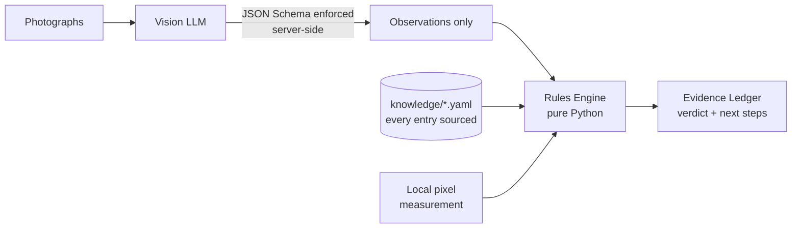

# AirPods Authenticator

Verify AirPods Pro 2 from photographs and get back an itemised **Evidence Ledger** —
every finding cited to a source, every open question turned into a specific photograph
to take.

> **Status:** working proof of concept, measured against 20 expert-labelled listings.
> **0 counterfeits passed as genuine, 0 genuine units accused.** Not production-ready:
> see [Honest limitations](#honest-limitations).

---

## The problem

The secondhand market is full of counterfeit AirPods carrying **cloned but valid**
serial numbers. Those serials pass Apple's `checkcoverage.apple.com` lookup, so the one
check most buyers know about returns a green light on a fake. Third-party verification
sites either cover few models or paywall the result — useless when you're standing in a
parking lot deciding whether to hand over $200.

## The approach

Counterfeits are hard to detect from a serial number and easy to detect from the box,
because Apple's packaging is manufactured to a fixed specification. A USB-C box never
carries a Lightning model number. A 2023 product never has a 2026 copyright. A genuine
set never repeats a serial across its case and earbuds.

Those are facts you can check with `if` statements — so the tool does exactly that, and
uses an LLM only for the part that genuinely needs vision.



**The model is never asked whether the item is genuine.** It's asked what the box says.
The verdict comes from deterministic rules, so every finding is explainable,
reproducible, and independently checkable by the buyer.

That boundary is enforced by the API rather than by prompt wording: the response is
constrained to a JSON Schema with `additionalProperties: false`, so the model *cannot*
return an opinion even if it ignores its instructions. A CI job asserts the schema
still has that property.

---

## Quickstart

```bash
python3 -m venv .venv && source .venv/bin/activate
pip install -r requirements.txt
export GEMINI_API_KEY=...          # free: https://aistudio.google.com/apikey

python main.py box_front.jpg box_underside.jpg case_lid.jpg
```

No API key needed to try it — bundled synthetic fixtures:

```bash
python main.py --extraction tests/sample_data/counterfeit_shrinkwrap.json
```

Exit codes: `0` genuine, `1` high risk, `2` inconclusive, `3` pipeline error.

### The web sheet

The same pipeline behind a browser. It renders the verdict as a graded examination
record: the box drawn unfolded as a plot diagram with each finding marked at the
surface it was read from, the graded rows beside it, and every check's source in fine
print beneath its finding.

```bash
cd web
npm install
npm run build && npm run preview     # http://localhost:4321
```

`GEMINI_API_KEY` must be set in the server's environment. The examination is a plain
form POST — it works with JavaScript disabled — and `web/src/lib/examine.ts` shells out
to `main.py`, so the browser never sees a rule and never renders a verdict of its own.
`web/src/data/sheet.ts` restates the rule table for the register and the plot;
`tests/test_web_contract.py` fails the build if that copy drifts from `rules_engine.py`.

---

## What it checks

Ground truth lives in [`knowledge/airpods_pro_2.yaml`](knowledge/airpods_pro_2.yaml).
**Every factual entry carries a `source`**, and tests enforce it — a rule without
provenance is an invented specification, which is how a counterfeit detector ends up
containing counterfeit information.

| Tier | Check | Fails when | Source |
|---|---|---|---|
| 1 | Model Number Compatibility | A-number belongs to the *other* variant, or isn't an Apple number at all | Apple |
| 2 | Serial Cross-Match | Serials that must match don't, or serials that must differ are identical | Community guide + Apple |
| 2 | Packaging Seal Type | Shrink-wrapped with no side pull tab | Community guide |
| 2 | Serial Label Format | Label prints `(S)Serial` with no space after the marker | Domain expert |
| 2 | Copyright Year Constraint | Year outside the variant's 2022–2025 range | Apple + domain expert |
| 2 | Typography & Print Quality | Misspellings printed on the packaging | Community guide |
| 2 | Serial Number Format | *soft, marked UNSOURCED — cannot disqualify* | — |
| — | Label Typography | *informational, weight 0 — see below* | Measurement |
| — | Photographed Surfaces | *observation only* | — |

**Serial Cross-Match is the one that can't be cloned around.** Apple prints a serial in
four places; the box and case-lid serials must match, and each earbud carries its own.
A counterfeiter copying one genuine serial passes Apple's lookup but would have to
reproduce four consistent serials to pass this.

### Identification beyond Pro 2

The knowledge base covers **28 model numbers** across every AirPods product Apple lists,
for identification only. Without it, an A-number from another generation is
indistinguishable from a fabricated one:

> Extracted model A3063 is a genuine Apple model number, but it belongs to **AirPods Pro
> 3** (introduced 2025), not AirPods Pro 2. This tool only verifies AirPods Pro 2, so no
> authenticity finding can be made — a counterfeit Pro 3 and a genuine one would both
> look like this here.

In the 20-post corpus, **3 items weren't Pro 2 at all** (two Pro 3, one AirPods 4 ANC).
Two of those had previously been reported as suspicious.

### What to photograph next

Rules declare which panels can answer them, which separates *"you didn't show me"* from
*"I looked and couldn't read it"* — only the first is fixed by another photo. Greedy set
cover gives the shortest list:

```
WHAT TO ASK FOR NEXT
  1. Photograph the sticker on the underside of the box — it carries the part
     number, the model numbers and the serial.
     (resolves: Model Number Compatibility, Serial Number Format)
  2. Copyright Year Constraint could not be read from the surfaces you did
     photograph — re-shoot them in even light.
```

---

## Measured results

20 listings from r/AreMyAirpodsAuthentic, labelled **blind** by a domain expert before
seeing any pipeline output:

```
agreement          11/20
counterfeits passed as genuine      0
genuine units accused               0
```

The disagreements are `INCONCLUSIVE` on items the expert could judge — the tool
declining rather than being wrong. For a buyer-protection tool that's the correct
direction to fail: a missed fake costs $200, an unnecessary re-photograph costs nothing.

Every rule change in this project came from that corpus. Three checks were **demoted
after measurement contradicted them**:

- **Kerning irregularity** — scored 0-for-2, firing only on genuine units. Blur,
  compression and viewing angle reproduce it on real packaging.
- **"Shoddy" shrink wrap** — the extractor reported wrap *and* shoddy wrap on an opened
  box with no plastic on it.
- **Accent-only misspellings** — a genuine box printing `Audífonos inalámbricos`
  correctly was accused because OCR dropped the diacritics. Letter substitutions
  (`MagSate`, `Appie`) still fail; missing accents don't.

---

## Honest limitations

**A `GENUINE` verdict is capped at 0.95 confidence.** This inspects packaging and
printed identifiers. It cannot detect a counterfeit carrying a cloned serial unless the
cross-match catches it. Telling a buyer a photo check is a certainty would reproduce the
problem the tool exists to solve.

**Font comparison does not work, and is disabled.** The tool renders San Francisco —
Apple's packaging typeface — and compares glyph geometry against it. On synthetic
renders this separates cleanly (SF 0.65% against 3.4–6.9% for Helvetica, Arial, Verdana
and Tahoma). On photographs it does not:

```
genuine AirPods Pro 2    4.72%
genuine AirPods 4 ANC    2.39%     ← variation within genuine
counterfeit Pro 3        6.78%        exceeds the gap to counterfeit
```

Photographed print carries texture, optical blur and sensor noise that rendered glyphs
don't. The rule is **informational with zero weight** and cannot move a verdict —
applying the synthetic threshold would have accused two genuine units. See
`font_forensics.py` for the full measurement record, including two approaches ruled out
(line advance-width ratios, and perspective-invariant cross-ratios, which are
mathematically elegant and font-blind at 0.0–0.8% separation).

**Only North American boxes are characterised.** Packaging *content* varies by region —
languages, regulatory marks, part-number suffix — so content rules don't transfer.
Typography does not vary, since Apple sets every region in San Francisco.

**The corpus is 20 posts.** Every number above rests on that.

---

## Development

```bash
pytest                      # full suite, no network or API key required
python -m pyflakes *.py tools/*.py tests/*.py
python tools/check_models.py    # probe which provider models actually serve requests
```

Iterate on rules without re-billing the vision stage — cached extractions are re-scored
against current rules automatically:

```bash
python tools/run_corpus.py corpus/ --out results/     # extract once
python tools/run_corpus.py --score results/           # re-score after any rule change
```

Blind labelling is built in: `results/review.csv` ships with `expert_verdict` blank, and
`--score` prints a confusion matrix that reports *"fake passed as genuine"* separately
from *"genuine flagged"* rather than averaging them.

```
schema.py           Pydantic contracts: the LLM's output + the Evidence Ledger
rules_engine.py     Rules, verdict aggregation, panel-aware next steps
knowledge/*.yaml    Ground truth — every entry sourced
providers.py        Gemini and Claude behind one protocol
font_forensics.py   Geometric typeface comparison (informational)
image_quality.py    Sharpness measurement
vision_extractor.py Prompt loading, image prep, local pixel analysis
tools/              Corpus fetch, batch scoring, model probing
web/                Astro front end — the examination record
```

### Notes for anyone extending this

- **Never assert an Apple specification from memory.** Cite Apple's page, ask the domain
  expert, or probe it live. Model availability included: `gemini-2.5-flash` is in
  Google's documented free-tier list and returns 404 for new accounts.
- **Subjective visual judgements have produced a false positive every time they were
  trusted.** Objective printed features have held up.
- Reference photographs under `knowledge/real_*` and `knowledge/fake` are **blocked from
  every vision API in code**, not by convention — they carry real serials, and free-tier
  terms allow the provider to retain submitted content.
- **Nothing published carries a whole serial.** The filed records on the web sheet come
  from real corpus examinations with the serials masked, and both the test suite and CI
  fail on a serial-shaped token in `web/src/data/specimens.json`.

## Roadmap

- Grow the labelled corpus; it has produced every real improvement so far
- Region ↔ regulatory-mark consistency (data is being collected; not yet enough to rule on)
- Extend verification beyond Pro 2 — the knowledge base is already structured for it
- Web frontend so the tool is usable from a phone during a meet-up
