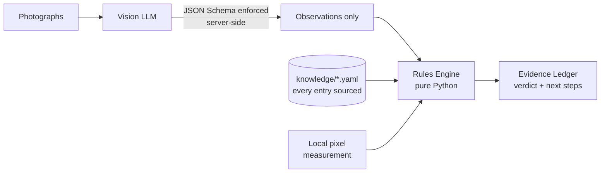

# AirPods Authenticator

Verify AirPods Pro 2 from photographs and get back an itemised **Evidence Ledger** —
every finding cited to a source, every open question turned into a specific photograph
to take.

> **Status:** working proof of concept, measured against 20 expert-labelled listings.
> **0 counterfeits passed as genuine, 0 genuine units accused.** Not production-ready:
> see [Honest limitations](#honest-limitations).

---

## The problem

The secondhand market is full of counterfeit AirPods carrying **cloned but valid**
serial numbers. Those serials pass Apple's `checkcoverage.apple.com` lookup, so the one
check most buyers know about returns a green light on a fake. Third-party verification
sites either cover few models or paywall the result — useless when you're standing in a
parking lot deciding whether to hand over $200.

## The approach

Counterfeits are hard to detect from a serial number and easy to detect from the box,
because Apple's packaging is manufactured to a fixed specification. A USB-C box never
carries a Lightning model number. A 2023 product never has a 2026 copyright. A genuine
set never repeats a serial across its case and earbuds.

Those are facts you can check with `if` statements — so the tool does exactly that, and
uses an LLM only for the part that genuinely needs vision.



**The model is never asked whether the item is genuine.** It's asked what the box says.
The verdict comes from deterministic rules, so every finding is explainable,
reproducible, and independently checkable by the buyer.

That boundary is enforced by the API rather than by prompt wording: the response is
constrained to a JSON Schema with `additionalProperties: false`, so the model *cannot*
return an opinion even if it ignores its instructions. A CI job asserts the schema
still has that property.

---

## Quickstart

```bash
python3 -m venv .venv && source .venv/bin/activate
pip install -r requirements.txt
export GEMINI_API_KEY=...          # free: https://aistudio.google.com/apikey

python main.py box_front.jpg box_underside.jpg case_lid.jpg
```

No API key needed to try it — bundled synthetic fixtures:

```bash
python main.py --extraction tests/sample_data/counterfeit_shrinkwrap.json
```

Exit codes: `0` genuine, `1` high risk, `2` inconclusive, `3` pipeline error.

### The web sheet

The same pipeline behind a browser. It renders the verdict as a graded examination
record: the box drawn unfolded as a plot diagram with each finding marked at the
surface it was read from, the graded rows beside it, and every check's source in fine
print beneath its finding.

```bash
cd web
npm install
npm run build && npm run preview     # http://localhost:4321
```

`GEMINI_API_KEY` must be set in the server's environment. The examination is a plain
form POST — it works with JavaScript disabled — and `web/src/lib/examine.ts` shells out
to `main.py`, so the browser never sees a rule and never renders a verdict of its own.
`web/src/data/sheet.ts` restates the rule table for the register and the plot;
`tests/test_web_contract.py` fails the build if that copy drifts from `rules_engine.py`.

### Deploying it

```bash
docker build -t airpods-verifier .
docker run -p 8080:8080 -e GEMINI_API_KEY=... airpods-verifier
```

The image carries both halves, because the web layer runs `main.py` as a
subprocess — the browser never evaluates a rule, so the rules engine has to be
on the same filesystem.

| variable | default | what it does |
|---|---|---|
| `GEMINI_API_KEY` | — | required; without it every examination returns a notice saying so |
| `PORT` / `HOST` | `8080` / `0.0.0.0` | listen address |
| `EXAMINE_CONCURRENCY` | `1` | vision calls at once. **Leave at 1.** Two concurrent calls on the free tier make both slow down and then fail |
| `EXAMINE_MAX_QUEUE` | `12` | waiting examinations before new ones are refused with a reason |
| `EXAMINE_PER_IP_HOURLY` | `6` | examinations per address per hour |
| `EXAMINE_PER_IP_DAILY` | `20` | examinations per address per day |
| `EXAMINE_DAILY_BUDGET` | `300` | total per day, everyone. **The one that bounds the bill** — a spoofed `X-Forwarded-For` defeats the per-address window but cannot defeat a total |
| `VERIFIER_ROOT` | found by walking up from cwd | where `main.py` lives |
| `RECORD_TOKEN` | unset | bearer token for `GET /api/record`. **Unset means the endpoint 404s** — it fails closed rather than exposing by omission |
| `RECORD_EXAMINATIONS` | on | set to `off` to record nothing at all |
| `SF_FONT_PATH` | macOS system path | Apple's typeface. Not in the image — its licence does not allow redistribution — so letterform checks report unavailable in a container |

**A caveat on all three limits.** The queue, the per-address window and the
daily budget all live in the server's memory, so a host that sleeps an idle
instance resets them on wake. The per-address window still works within a busy
period, but the daily budget is only a real cap while the instance stays up.
On a scale-to-zero plan it is a speed bump, not a ceiling — worth knowing before
pointing anyone at the URL.

**Two constraints any host must satisfy**, both because examinations are
serialised in-process:

- **One instance.** The queue lives in the server's memory. Two instances means
  two queues means two concurrent vision calls, which is the thing the queue
  exists to prevent.
- **CPU allocated outside the request.** The submit endpoint returns a job id
  immediately and the pipeline keeps running after the response is sent. A host
  that throttles CPU between requests will stall it.

**Cloud Run needs a payment card.** It refuses to enable its own API without a
billing account (`UREQ_PROJECT_BILLING_NOT_FOUND`) even though this workload
sits inside the always-free tier, so the charge is $0 but the card is not
optional. With billing attached:

```bash
gcloud run deploy airpods-verifier --source . \
  --max-instances=1 --no-cpu-throttling \
  --set-env-vars GEMINI_API_KEY=...
```

Scale-to-zero is fine: a job id that outlives its instance returns "that
examination is no longer on the server", which the sheet renders as a notice
rather than a hang.

**Render needs no card.** `render.yaml` in this repository is a ready blueprint
— connect the repo and set `GEMINI_API_KEY` in the dashboard. The trade is 0.1
CPU and 512 MB, and the instance sleeps after 15 minutes idle, so a visitor
after a quiet spell waits about a minute for the cold start on top of the
vision call.

### What the deployed sheet records

Every real improvement in this project came from measuring a corpus. A public
test round with no record produces anecdotes instead, so each examination
writes one anonymous line — to stdout, where the host's log viewer keeps it,
and to a small ring buffer that `GET /api/record` reads back with a token.

Records are written to stdout whatever `RECORD_TOKEN` is set to — the host's
log viewer keeps them, and `grep examination` finds them. The token only makes
them readable over HTTP; an unset token loses nothing.

**Never recorded:** photographs, filenames, file sizes, serial numbers, model
numbers, any extracted text, IP addresses, user agents, or anything derived
from them. Panels are fixed enum values, verdicts are one of three words, and
weights are numbers the rule table already publishes. `tools/record.test.mjs`
fails if a serial-shaped token or any identity field reaches a record.

The session id is generated in the browser, kept in `sessionStorage`, and dies
with the tab. It exists to tell a second attempt from a second person, which is
the one behavioural question worth asking:

```
"warning": { "sessions": 1, "warnedOnce": 1,
             "addedAfterWarning": 1, "retriedUnchanged": 0,
             "stoppedAfterWarning": 0 }
```

The sheet warns before an examination that cannot reach a verdict. That feature
was built on corpus data and has never been tested on a person — this measures
whether it changes what anyone photographs.

### Labelling what came back

A record says what the tool decided, not whether it was right. `POST
/api/record`, behind the same token, attaches the answer afterwards:

```bash
curl -X POST https://airpods-verifier.onrender.com/api/record \
     -H "Authorization: Bearer $RECORD_TOKEN" \
     -H 'Content-Type: application/json' \
     -d '{"id":"v8wxec","truth":"COUNTERFEIT"}'
```

`GET` then reports the live confusion matrix, led by the two numbers that have
governed every decision in this project:

```
"agreement": { "labelled": 12, "counterfeitPassedAsGenuine": 0,
               "genuineAccused": 0, "counterfeitCaught": 3,
               "genuineCleared": 5, "inconclusive": 4 }
```

The live matrix is computed from the in-memory buffer, which the free tier
discards after fifteen minutes idle — so label an examination while the session
is still warm. Nothing is actually lost if you don't: both the `examination`
and `examination-label` lines reach stdout, and `tools/read_record.py` joins
them by id from a downloaded log, which is the durable path.

**A labelled record cannot be re-scored.** The record keeps no photographs, by
design, so unlike the offline corpus it can never be replayed against a rule
written later — it measures the rules as they stood when the examination ran,
and nothing else. It exists because eBay's rejection closed the last automated
collection route, leaving the deployed tool as the only corpus still growing.

---

## What it checks

Ground truth lives in [`knowledge/airpods_pro_2.yaml`](knowledge/airpods_pro_2.yaml).
**Every factual entry carries a `source`**, and tests enforce it — a rule without
provenance is an invented specification, which is how a counterfeit detector ends up
containing counterfeit information.

| Tier | Check | Fails when | Source |
|---|---|---|---|
| 1 | Model Number Compatibility | A-number belongs to the *other* variant, or isn't an Apple number at all | Apple |
| 2 | Serial Cross-Match | Serials that must match don't, or serials that must differ are identical | Community guide + Apple |
| 2 | Packaging Seal Type | Shrink-wrapped with no side pull tab | Community guide |
| 2 | Serial Label Format | Label prints `(S)Serial` with no space after the marker | Domain expert |
| 2 | Copyright Year Constraint | Year outside the variant's 2022–2025 range | Apple + domain expert |
| 2 | Typography & Print Quality | Misspellings printed on the packaging | Community guide |
| 2 | Serial Number Format | *soft, marked UNSOURCED — cannot disqualify* | — |
| — | Label Typography | *informational, weight 0 — see below* | Measurement |
| — | Photographed Surfaces | *observation only* | — |

**Serial Cross-Match is the one that can't be cloned around** — and it has never
once run. Apple prints a serial in four places; the box and case-lid serials must
match, and each earbud carries its own. A counterfeiter copying one genuine serial
passes Apple's lookup but would have to reproduce four consistent serials to pass
this. On the corpus it is 0 PASS, 0 FAIL, 20 UNKNOWN, because only the box-label
serial was ever legible. See *Honest limitations*.

### Identification beyond Pro 2

The knowledge base covers **28 model numbers** across every AirPods product Apple lists,
for identification only. Without it, an A-number from another generation is
indistinguishable from a fabricated one:

> Extracted model A3063 is a genuine Apple model number, but it belongs to **AirPods Pro
> 3** (introduced 2025), not AirPods Pro 2. This tool only verifies AirPods Pro 2, so no
> authenticity finding can be made — a counterfeit Pro 3 and a genuine one would both
> look like this here.

In the 20-post corpus, **3 items weren't Pro 2 at all** (two Pro 3, one AirPods 4 ANC).
Two of those had previously been reported as suspicious.

### What to photograph next

Rules declare which panels can answer them, which separates *"you didn't show me"* from
*"I looked and couldn't read it"* — only the first is fixed by another photo. Greedy set
cover gives the shortest list:

```
WHAT TO ASK FOR NEXT
  1. Photograph the sticker on the underside of the box — it carries the part
     number, the model numbers and the serial.
     (resolves: Model Number Compatibility, Serial Number Format)
  2. Copyright Year Constraint could not be read from the surfaces you did
     photograph — re-shoot them in even light.
```

---

## Measured results

20 listings from r/AreMyAirpodsAuthentic, labelled **blind** by a domain expert before
seeing any pipeline output:

```
agreement          12/20
counterfeits passed as genuine      0
genuine units accused               0
```

Almost every disagreement is `INCONCLUSIVE` on an item the expert could judge — the tool
declining rather than being wrong. For a buyer-protection tool that's the correct
direction to fail: a missed fake costs $200, an unnecessary re-photograph costs nothing.

The same photographs give the same answer. Fifteen runs across three photo sets
— one producing a finding, one marginal, one unreadable — returned identical
verdicts and scores; the only variation was a panel label on a set where every
check was already unknown. Sampling is not pinned, so this is measured rather
than structural, and the likely reason is the schema-constrained extraction
leaving little room to vary.

Every rule change in this project came from that corpus. Four checks were **demoted
after measurement contradicted them**:

- **Kerning irregularity** — scored 0-for-2, firing only on genuine units. Blur,
  compression and viewing angle reproduce it on real packaging.
- **"Shoddy" shrink wrap** — the extractor reported wrap *and* shoddy wrap on an opened
  box with no plastic on it.
- **Accent-only misspellings** — a genuine box printing `Audífonos inalámbricos`
  correctly was accused because OCR dropped the diacritics. Letter substitutions
  (`MagSate`, `Appie`) still fail; missing accents don't.

---

## Honest limitations

**A `GENUINE` verdict is capped at 0.95 confidence.** This inspects packaging and
printed identifiers. It cannot detect a counterfeit carrying a cloned serial unless the
cross-match catches it. Telling a buyer a photo check is a certainty would reproduce the
problem the tool exists to solve.

**Font comparison does not work, and is disabled.** The tool renders San Francisco —
Apple's packaging typeface — and compares glyph geometry against it. On synthetic
renders this separates cleanly (SF 0.65% against 3.4–6.9% for Helvetica, Arial, Verdana
and Tahoma). On photographs it does not:

```
genuine AirPods Pro 2    4.72%
genuine AirPods 4 ANC    2.39%     ← variation within genuine
counterfeit Pro 3        6.78%        exceeds the gap to counterfeit
```

Photographed print carries texture, optical blur and sensor noise that rendered glyphs
don't. The rule is **informational with zero weight** and cannot move a verdict —
applying the synthetic threshold would have accused two genuine units. See
`font_forensics.py` for the full measurement record, including two approaches ruled out
(line advance-width ratios, and perspective-invariant cross-ratios, which are
mathematically elegant and font-blind at 0.0–0.8% separation).

**Only North American boxes are characterised.** Packaging *content* varies by region —
languages, regulatory marks, part-number suffix — so content rules don't transfer.
Typography does not vary, since Apple sets every region in San Francisco.

**The strongest check has never fired.** Serial Cross-Match carries 4.0 of the 19.5
total and is the only check a cloned serial cannot defeat. Across 20 posts it is 0
PASS, 0 FAIL, 20 UNKNOWN — the box-label serial was legible 7 times, the case-lid and
both earbud serials never:

```
box label serial      7 of 20
case lid serial       0 of 20
left earbud serial    0 of 20
right earbud serial   0 of 20
```

The case lid was *in frame* in 7 of those posts, so it is not that people fail to
photograph it. Measured cause is framing distance: rendered the way the real thing
looks, a lid filling the frame reads correctly at the pipeline's 1568px downscale,
and the same lid at arm's length does not read at all. The capture guidance now says
so. The practical consequence is that coverage tops out at 15.5 of 19.5 (79.5%), so
the 60% floor for a verdict is really 75% of what is obtainable — nothing is
reweighted, because erring toward `INCONCLUSIVE` is the safe direction.

**The corpus is 20 posts.** Every number above rests on that.

---

## Development

```bash
pytest                      # full suite, no network or API key required
python -m pyflakes *.py tools/*.py tests/*.py
python tools/check_models.py    # probe which provider models actually serve requests
```

Iterate on rules without re-billing the vision stage — cached extractions are re-scored
against current rules automatically:

```bash
python tools/run_corpus.py corpus/ --out results/     # extract once
python tools/run_corpus.py --score results/           # re-score after any rule change
```

Corpus from eBay listings, through eBay's own API — not a scraper. eBay's
robots.txt prohibits automated access and names LLM-driven bots specifically,
directing integrations to the Browse API.

**This route is currently closed to this project.** The developer registration
was rejected — "your account registration was rejected due to problems with the
data provided or other irregularities", with no specific reason given and no
appeal offered. The client below is complete and tested against eBay's
published schema, so it works for anyone whose registration is accepted, but
nothing here can be collected without that. Register at
[developer.ebay.com](https://developer.ebay.com/), then:

```bash
export EBAY_CLIENT_ID=... EBAY_CLIENT_SECRET=...
python tools/fetch_ebay.py --probe                      # one call: does the API still look like this?
python tools/fetch_ebay.py --query "airpods pro 2nd generation" --limit 40 --out corpus/
```

Run `--probe` first. Every field name here was written against eBay's
published schema, and documentation drifts — one call reports which of them the
API actually returned, rather than a forty-listing run failing on the fortieth.

Every image passes `tools/stock_photos` first. Sellers pad listings with
Apple's own press photography, which is a picture of a genuine unit attached to
a listing that may not be one — the fastest way to corrupt a corpus. Detection
is by cross-listing reuse: a photograph of a specific box on a specific table
cannot honestly appear in two unrelated listings, while a press shot appears in
hundreds. No reference images and no judgement about Apple's photography
required. Measured on the reference set plus synthetic press shots: 30 real
photographs kept, 4 press shots dropped, no errors either way.

Blind labelling is built in: `results/review.csv` ships with `expert_verdict` blank, and
`--score` prints a confusion matrix that reports *"fake passed as genuine"* separately
from *"genuine flagged"* rather than averaging them.

```
schema.py           Pydantic contracts: the LLM's output + the Evidence Ledger
rules_engine.py     Rules, verdict aggregation, panel-aware next steps
knowledge/*.yaml    Ground truth — every entry sourced
providers.py        Gemini and Claude behind one protocol
font_forensics.py   Geometric typeface comparison (informational)
image_quality.py    Sharpness measurement
vision_extractor.py Prompt loading, image prep, local pixel analysis
tools/              Corpus fetch, batch scoring, model probing
web/                Astro front end — the examination record
```

### Notes for anyone extending this

- **Never assert an Apple specification from memory.** Cite Apple's page, ask the domain
  expert, or probe it live. Model availability included: `gemini-2.5-flash` is in
  Google's documented free-tier list and returns 404 for new accounts.
- **Subjective visual judgements have produced a false positive every time they were
  trusted.** Objective printed features have held up.
- Reference photographs under `knowledge/real_*` and `knowledge/fake` are **blocked from
  every vision API in code**, not by convention — they carry real serials, and free-tier
  terms allow the provider to retain submitted content.
- **Nothing published carries a whole serial.** The filed records on the web sheet come
  from real corpus examinations with the serials masked, and both the test suite and CI
  fail on a serial-shaped token in `web/src/data/specimens.json`.

## Roadmap

- Grow the labelled corpus; it has produced every real improvement so far
- Region ↔ regulatory-mark consistency (data is being collected; not yet enough to rule on)
- Extend verification beyond Pro 2 — the knowledge base is already structured for it
- ~~Web frontend so the tool is usable from a phone during a meet-up~~ — done
- A counterfeit label photographed close enough to calibrate the letterform
  check (glyphs 45px or taller). It is the one measurement that would move that
  rule off weight 0, and the rule now asks every user for exactly that shot
