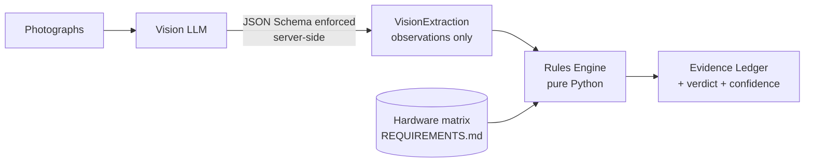

# AirPods Pro 2 Authenticator

Verify AirPods Pro 2 (Lightning and USB-C) from photographs, and get back an
itemised **Evidence Ledger** explaining every finding — not a black-box score.

> **Status:** proof of concept. The rules engine is complete and tested; the
> vision stage has been verified against both APIs' request surfaces but has not
> yet been run against a corpus of real photographs.

---

## The problem

The secondhand market is full of counterfeit AirPods carrying **cloned but
valid** serial numbers. Those serials pass Apple's `checkcoverage.apple.com`
lookup, so the one check most buyers know about returns a green light on a fake.
The existing third-party verification sites either cover few models or paywall
the result — which is useless when you are standing in a parking lot deciding
whether to hand over $200.

## The approach

Counterfeits are hard to detect from a serial number, but easy to detect from
the box, because Apple's packaging is manufactured to a fixed specification.
A USB-C box never carries a Lightning model number. A retail Pro 2 box is never
shrink-wrapped. A 2023 product never has a 2021 copyright line.

Those are facts you can check with `if` statements — so this tool does exactly
that, and uses an LLM only for the part that genuinely needs vision.



**The model is never asked whether the item is genuine.** It is asked what the
box says. The verdict comes from deterministic rules, which means every finding
is explainable, reproducible, and unit-testable — and a buyer can independently
check any line in the ledger.

That boundary is enforced by the API rather than by prompt wording: both
providers constrain the response to the `VisionExtraction` JSON Schema with
`additionalProperties: false`, so the model *cannot* return an opinion even if
it ignores its instructions. [A test asserts this.](tests/test_rules.py)

---

## Quickstart

```bash
python3 -m venv .venv && source .venv/bin/activate
pip install -r requirements.txt

# Free: get a key at https://aistudio.google.com/apikey
export GEMINI_API_KEY=...

python main.py box_front.jpg box_underside.jpg case.jpg
```

Try it with no API key at all, using the bundled synthetic fixtures:

```bash
python main.py --extraction tests/sample_data/counterfeit_shrinkwrap.json
```

```
TIER 1 - HARDWARE IDENTITY MATRIX
  [FAIL] Model Number Compatibility
         Cross-variant mismatch: A2700 belongs to Pro 2 Lightning Charging
         Case, but the item is presented as Pro 2 USB-C. Genuine packaging
         never pairs one variant's model number with the other's branding.

TIER 2 - PACKAGING & VISUAL SIGNATURES
  [FAIL] Packaging Seal Type
         Full plastic shrink wrap detected. Retail AirPods Pro 2 boxes are
         sealed with paper pull-tabs bearing green arrows on the top and
         bottom seams and never ship in plastic shrink wrap.
  ...

  VERDICT: HIGH RISK - do not buy without further checks
  Confidence: 0.99
```

Exit codes: `0` genuine, `1` high risk, `2` inconclusive, `3` pipeline error.

---

## Choosing a vision provider

The extraction stage is pluggable. The rules engine is identical either way, and
both providers get byte-identical prompts and images — so any difference in the
ledger is a difference in the model, not the harness.

| Provider | Model | Cost per check¹ | Notes |
|---|---|---|---|
| **Gemini** (default) | `gemini-3.8-flash` | **$0** | Google AI Studio free tier. Rate limited. |
| Claude | `claude-haiku-4-5` | ~$0.009 | ~110 checks per $1 |
| Claude | `claude-sonnet-5` | ~$0.018 | ~55 checks per $1 |
| Claude | `claude-opus-5` | ~$0.046 | ~22 checks per $1 |

¹ Three photos downscaled to 1568 px (~8.1K input tokens, ~200 output). Rates
drift — see each provider's pricing page.

```bash
python main.py box.jpg                          # Gemini, free
python main.py box.jpg --provider anthropic     # Claude, needs ANTHROPIC_API_KEY
python main.py box.jpg --effort low             # cheaper / faster on either
```

### Two caveats about the free tier

Worth understanding before pointing real users at it:

1. **Google uses free-tier content to improve its products.** Paid tiers
   explicitly do not. If this becomes a public tool, strangers will be uploading
   photos that may include serial numbers, faces, or their home in the
   background — that needs to be disclosed to them, or the app needs a paid key.
2. **Free-tier rate limits are per-account and capped per day.** They are fine
   for development and a small launch, and they are a hard ceiling on adoption.
   Google publishes current limits in the AI Studio dashboard rather than as a
   fixed table.

Neither is a reason to avoid the free tier for a PoC. Both are reasons to keep
the provider swappable, which is why it is.

---

## What the engine checks

Ground truth lives in [REQUIREMENTS.md](REQUIREMENTS.md); the engine imports it
as data, so adding a variant means editing a table, not writing rules.

**Tier 1 — hardware identity**

| Check | Fails when |
|---|---|
| Model Number Compatibility | The A-number is not a Pro 2 part, or belongs to the *other* variant |

**Tier 2 — packaging & visual signatures**

| Check | Fails when |
|---|---|
| Packaging Seal Type | Plastic shrink wrap is present (genuine boxes use paper pull-tabs) |
| Copyright Year Constraint | Year predates the variant's release, or is in the future |
| Serial Number Format | Not 10 or 12 uppercase alphanumerics |
| Typography & Print Quality | Misspellings or kerning defects in printed text |

Tier is about *evidence class*, not severity. Some Tier 2 findings are
physically impossible on a genuine unit, so rules carry a separate
`disqualifying` flag — plastic shrink wrap alone condemns an otherwise perfect
unit.

### Design decisions worth knowing

- **A `GENUINE` verdict is capped at 0.95 confidence.** This pipeline inspects
  packaging and printed identifiers. It cannot detect a counterfeit carrying a
  cloned serial — the exact failure mode of Apple's own lookup. Telling a buyer
  a photo check is a certainty would reproduce the problem this tool exists to
  solve, so the ledger says so instead.
- **Missing evidence is never treated as passing evidence.** An unreadable Tier 1
  model number forces `INCONCLUSIVE`, even when every visible check passes.
- **Serial validation is format-only, and sits in Tier 2.** REQUIREMENTS.md does
  not specify Apple's serial format, and an over-strict length rule would
  false-positive on genuine units — the worst possible failure for this tool.

---

## Development

```bash
pytest                    # 113 tests, no network or API key required
python -m pyflakes *.py
```

The rules engine is tested exhaustively on synthetic extractions, and both
providers are driven by stub clients that capture the request — so CI runs green
without credentials and without spending money.

Iterate on the rules without re-billing the vision stage:

```bash
python main.py box.jpg --save-extraction run.json   # one API call
python main.py --extraction run.json                # re-score for free
```

That is also how you A/B two models on identical inputs: save an extraction from
each provider and diff the ledgers.

```
schema.py           Pydantic contracts: the LLM's output + the Evidence Ledger
rules_engine.py     Ground-truth matrix, the five rules, verdict aggregation
providers.py        Gemini and Claude backends behind one protocol
vision_extractor.py Prompt loading, image downscaling, provider dispatch
main.py             CLI and ledger rendering
PROMPTS.md          The system prompt, loaded at runtime — edit it here
REQUIREMENTS.md     Hardware ground truth
```

## Roadmap

- Validate extraction accuracy against a labelled corpus of real listing photos
- Compare Gemini Flash against Claude on that corpus before committing to one
- Extend the matrix beyond Pro 2 (Pro 1, AirPods 3/4, Max)
- Web frontend so the tool is usable from a phone during a meet-up
